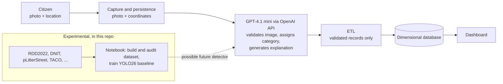

# Vish

[](https://colab.research.google.com/github/alvesskaio/colab/blob/main/notebooks/Vish_Dataset_v2_1_YOLO26_Robusto_Colab.ipynb)

Academic project for the *Computer Vision* course (IBM3131, AP1) of the Data Science and AI program at Ibmec. This repository accompanies the project article and documents the software used and the group's own implementations.

> **Scope of this repository.** The only code versioned here is the Colab notebook for the experimental YOLO26 detection baseline (dataset building, auditing, training and evaluation). The Vish application itself (capture, LLM classification, ETL, dashboard) is described below because it is the context of the project, but **its source code is not part of this repository**. <!-- TODO: link the repository/location of the application code, or add it under app/. -->

## What is Vish and the problem it addresses

Vish lets a citizen report an urban problem (pothole, garbage, hanging wire, etc.) by sending a photo together with its location. The goal is to turn those reports into structured, validated data that a city can analyze.

## Architecture



Flow, as designed by the group:

1. The citizen sends a photo and coordinates; both are persisted.
2. GPT-4.1 mini validates the image, assigns a category and generates a natural-language explanation.
3. An ETL loads the validated records into a dimensional database.
4. A dashboard reads from that database.

The YOLO26 baseline in `notebooks/` is **not** part of this production flow. It is an experiment on object detection (box, class and confidence) and is explicitly not integrated (see [Status and limitations](#status-and-limitations)).

## Repository structure

```
.
├── README.md
├── .gitignore
├── notebooks/
│   └── Vish_Dataset_v2_1_YOLO26_Robusto_Colab.ipynb   # YOLO26 baseline (Colab, GPU)
└── docs/
    ├── DEVELOPMENT.md                                  # stages, decisions, difficulties
    └── img/
```

## How to run

### Notebook (YOLO26 baseline)

1. Click the **Open in Colab** badge above (it works once the repository is public; otherwise upload the `.ipynb` to Colab).
2. Set *Runtime → Change runtime type → GPU*.
3. Run the cells in order. The notebook:
   - installs `ultralytics`, `kagglehub`, `pycocotools`, `imagehash`, `pyyaml`, `tqdm`, `seaborn`;
   - mounts Google Drive and uses `MyDrive/Vish/v2/` as workspace (raw data, unified dataset, artifacts, runs);
   - downloads RDD2022 (selected countries), pLitterStreet (13.7 GB, smoke profile only) and TACO (a Kaggle mirror) automatically;
   - processes the other sources only if you place them manually in `MyDrive/Vish/v2/manual_sources/` (see the notebook, section 6).
4. Pick the profile in the configuration cell (`PROFILE`):

   | | `smoke` (default) | `serious` |
   |---|---|---|
   | Images per source | up to 500 | no limit |
   | Epochs | 10 | 100 |
   | Image size | 640 | 960 |
   | Strict coverage gate | off | on (training is blocked if coverage is insufficient) |

   The `smoke` profile only validates the pipeline. The `serious` profile requires the manual sources, notably reviewed own data for `dangerous_wire`.

No API keys or environment variables are required by the notebook. <!-- TODO: add .env.example once the application code and its variables (e.g. OpenAI key, database URL) are included or referenced. -->

### Application

TODO: not included in this repository (see the note at the top). Add run instructions, or a link, once the application code location is defined.

## Third-party software and data

| Component | Use in the project | License |
|---|---|---|
| [Ultralytics YOLO26](https://docs.ultralytics.com/models/yolo26/) | Detection model and training framework (pretrained COCO weights, transfer learning) | TODO: confirm the Ultralytics license terms (they have an open-source and an enterprise option) before redistribution |
| [RDD2022](https://github.com/sekilab/RoadDamageDetector) | Main source of `pothole` and `damaged_road` | CC BY-SA 4.0 |
| [Cracks and Potholes in Road Images (DNIT, Brazil)](https://data.mendeley.com/datasets/t576ydh9v8/4) | Brazilian `pothole`; masks converted to boxes | CC BY 4.0 |
| [pLitterStreet](https://zenodo.org/records/8288500) | Main source of `garbage` | Not stated in the notebook ("check the record's terms"); TODO |
| [TACO](https://github.com/pedropro/TACO) | Complement for `garbage` (via Kaggle mirror) | Per-image licenses |
| [MOMRAH](https://data.mendeley.com/datasets/bb7b8vtwry/5) | Optional `pothole` reinforcement | CC BY 4.0 |
| [WasteInsight](https://data.mendeley.com/datasets/p8n7nbxyw3/1) | Brazilian `garbage` reinforcement | CC BY 4.0 |
| [QR4Change](https://data.mendeley.com/datasets/zndzygc3p3/2) | Hard negatives only | CC BY 4.0 |
| [Flood Dataset-1](https://data.mendeley.com/datasets/px48m7vwvf/3) | `flooding` (general class only) | CC BY 4.0 |
| [Tree-Wires](https://github.com/arturandre/tree-wires), [AirLab Wire Detection](https://theairlab.org/wire-detection/) | Auxiliary context only; not converted to boxes | Not stated in the notebook; TODO |
| GPT-4.1 mini (OpenAI API) | Image validation, categorization and explanation in the application | Subject to OpenAI's API terms |

Data licenses are not equivalent. RDD2022 is ShareAlike, so derived datasets and models trained on it should be checked before redistribution or commercial use. Datasets and model weights are **not** versioned in this repository (see `.gitignore`).

## Group implementations

What the group wrote, as opposed to the third-party software above.

**In this repository (notebook):**

- **Dataset importers and converters** to a single YOLO detection format: Pascal VOC (RDD2022), COCO (pLitterStreet, TACO), segmentation masks to boxes via connected components (DNIT), YOLO sources, and image-level negatives (QR4Change). The v2.1 fix makes the COCO importer resolve the full relative image path.
- **Per-image provenance manifest** (source, original split, group, number of boxes, negative flag).
- **Deduplication** by MD5 and perceptual hash (pHash) with a source-priority order; it also protects files still referenced by the manifest.
- **Leakage-free split**: deterministic split by group, with neighboring frames grouped by sequence number so they never land in different splits, plus a leakage audit by MD5, pHash and group.
- **Coverage audit**: label/coordinate validation and a minimum-boxes-per-class gate that blocks the `serious` profile, plus a hard-negative ratio check.
- **Evaluation protocol**: validation metrics per class, a dedicated test split intended for Brazilian phone photos never used in training, false-positive rate on hard negatives, and per-class confidence thresholds.
- **Inference cell** that takes an uploaded photo and draws box, class and confidence.

**Part of the Vish system, code not included here:**

- Photo and coordinates capture and persistence pipeline.
- Prompt and classification agent (GPT-4.1 mini).
- ETL to the dimensional database.
- Dashboard.

<!-- TODO: add links/paths once that code is available. -->

## Status and limitations

- The YOLO26 baseline is **experimental**. It has not been integrated into the application and has not been validated for production.
- The outputs saved in the notebook come from the `smoke` profile (10 epochs, 640 px, `yolo26s`). In that run only TACO contributed images (500; pLitterStreet imported 0 because its images could not be resolved), so only the `garbage` class has data; the coverage gate warned of insufficient coverage and there were 0.0% negatives in training. On its 58-image validation split the saved log reports, for `garbage`, precision 0.681, recall 0.400, mAP50 0.461 and mAP50-95 0.323. These numbers only show that the pipeline runs end to end; they are not evidence of detector quality. The metrics cell also ends with a `ValueError: All arrays must be of the same length` in the saved output (the per-class table assumes 5 classes while only one had data).
- The ~99% figure mentioned in the article is an engineering indicator computed on a small sample. It is **not** a validated accuracy, and no log in this repository reproduces it. <!-- TODO: point to the script/log that produces it, or remove the sentence. -->
- Most training data is international. Generalization to Brazilian street photos is untested: no `vish_br_test` set is included.
- `dangerous_wire` has no suitable public dataset; the `serious` profile requires own, reviewed data, which is not part of this repository.
- The per-class thresholds in the notebook are initial values, not tuned.
- A detected dangerous wire should be treated as triage, not as a technical report.

## Development documentation

See [`docs/DEVELOPMENT.md`](docs/DEVELOPMENT.md).

## License

TODO: pending decision (see open questions).
